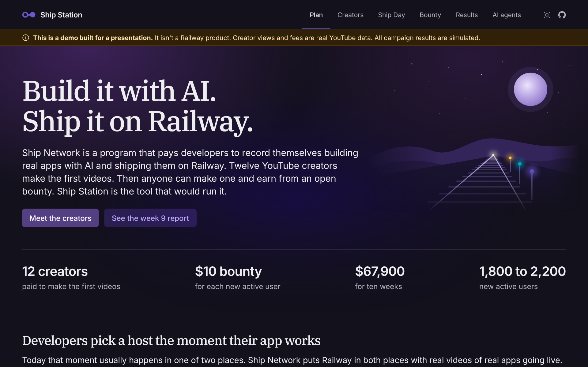

# Ship Network

**Build it with AI. Ship it on Railway.**

Ship Network is a creator campaign concept for Railway. This repo also holds the app that would run it. Tutorial creators each record a YouTube video of building a real app with an AI coding agent and deploying it on Railway. Each video ends with a link that deploys the same app. The link carries the creator's referral code. An open bounty pays anyone else who brings new users with their own videos. The campaign is judged on activated signups. An activated signup is a new user from a creator's link whose first deploy is still running a week later.

Live app: [ship-station-production-9b0e3795.up.railway.app](https://ship-station-production-9b0e3795.up.railway.app)



## What is in this repo

| Folder | What it is |
|---|---|
| [`ship-station/`](ship-station) | The app that runs the campaign. It has the creator list with live YouTube data, each creator's links, a forecast calculator, a Ship Day plan with each creator's status, the Deploy Bounty form with automatic checks, a results page, the agent pick panel and a badge generator. It is built with Next.js and Postgres. The interface uses the Radix Themes design system. Its colors and fonts follow railway.com. |
| [`.railway/railway.ts`](.railway/railway.ts) | The whole Railway project as code: one web service and one Postgres database. |
| [`agent-pick-panel/`](agent-pick-panel) | Sends fixed deploy prompts to Claude Code, Codex or Cursor and records which host each one recommends. |
| [`skills/heroku-to-railway/`](skills/heroku-to-railway) | An agent skill for the Heroku episode. It plans a move from Heroku and drafts the `.railway/railway.ts`. |
| [`campaign/`](campaign) | The creator brief, the Ship Day run of show and the outreach email. |

## Deploy a copy

The quickest way is the "Fork this app on Railway" button in the live app's footer. It deploys from the Railway template.

With the Railway CLI:

```bash
npm install            # installs Railway's infrastructure as code SDK
railway login
railway init           # creates a new project
railway config plan    # shows postgres and ship-station
railway config apply
```

Then set two variables on **ship-station** and add a domain:

```bash
railway variable set --service ship-station YOUTUBE_API_KEY=your-key
railway variable set --service ship-station ADMIN_TOKEN=$(openssl rand -hex 24)
railway domain --service ship-station
```

The YouTube key is optional. The app refreshes channel stats once a day when the key is set. It uses the last stats saved in the repo when the key is missing. The app also runs without a database. Bounty entries are then checked but not saved.

## Run the agent pick panel

Run this on a machine where Claude Code is signed in. Codex and Cursor are optional.

```bash
node agent-pick-panel/run.mjs --agents claude \
  --post https://your-ship-station-domain/api/agent-panel --token YOUR_ADMIN_TOKEN
```

## What is real and what is simulated

Railway's signup and deploy data is internal. Signup counts, cost per activated signup and the before and after comparison come from a model of the plan. The app marks those numbers as Simulated.

Everything else is real:

- The creator list
- Subscriber counts and median views from the YouTube Data API
- The fees set from those views
- The bounty checks against YouTube and GitHub
- Agent pick panel runs

Built by Asaf Ashirov as an independent project. It is not a Railway product and is not affiliated with Railway.
